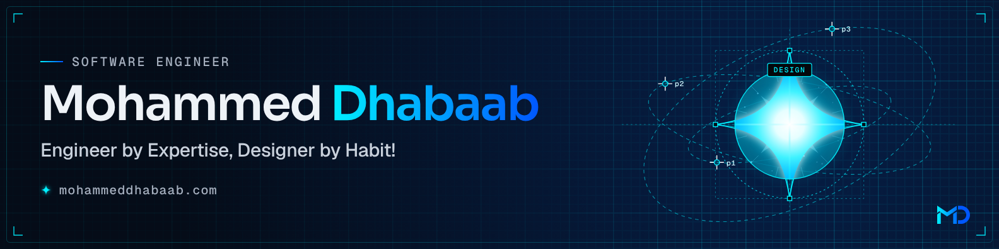

<h3 align="center">I Engineer Scalable Solutions that Deliver Measurable Results!</h3>

  With you! Mohammed Dhabaab, a Software Developer at <b>NSG Geospatial Services</b>. I build enterprise, business, and government products, lead the frontend on some of them, and design the interfaces I build!

  <b>8</b> products delivered · <b>160+</b> features shipped · <b>40+</b> features in one rebuild 

  <a href="https://www.mohammeddhabaab.com"><b>Portfolio</b></a> ·
  <a href="https://www.mohammeddhabaab.com/work">Selected work</a> ·
  <a href="https://www.mohammeddhabaab.com/resume">Résumé</a> ·
  <a href="https://www.linkedin.com/in/mohammed-dhabaab/">LinkedIn</a> ·
  <a href="https://leetcode.com/u/Mohammed_Dhabaab/">LeetCode</a> ·
  <a href="mailto:mohammed.dhabaab@gmail.com">Email</a>

## About

Proud software engineer with over **2+ years** of experience building web applications that scale, stay maintainable, and put users first, specializing in the **frontend**. On production apps, I work across API and backend integration, reusable component architecture, state and data management, performance, testing, and code reviews!

I’m also growing beyond the frontend into **full-stack engineering**, software architecture, and AI-powered applications, and I'm always **looking for better** ways to build products and solve problems!

## Skills

The tools behind the work. It’s the same map as on [my portfolio](https://www.mohammeddhabaab.com/#stack), where each tool links to where I used it.

### Frontend

  
  
  
  
  
  
  
  
  
  
  
  
  
  

Next.js · React · TypeScript · JavaScript · Tailwind CSS · Sass · CSS · HTML · React Query · Redux · Zustand · Axios · ESLint · Prettier

### Backend & Databases

  
  
  
  
  
  
  
  

Node.js · Next.js · Express · Python · MongoDB · PostgreSQL · SQL · Docker

### Testing & Build

  
  
  

Vitest · Vite · Playwright

### Version Control & Host

  
  
  

Git · GitHub · Vercel

### Design

  
  
  
  

Figma · Canva · Blender · Unity

## Contact

I’m open to the right role. Email is the fastest way to reach me: for a role, an interview, a collaboration, or a question about my work, write anytime!

[mohammed.dhabaab@gmail.com](mailto:mohammed.dhabaab@gmail.com) · [LinkedIn](https://www.linkedin.com/in/mohammed-dhabaab/) · [Contact form](https://www.mohammeddhabaab.com/#contact)
